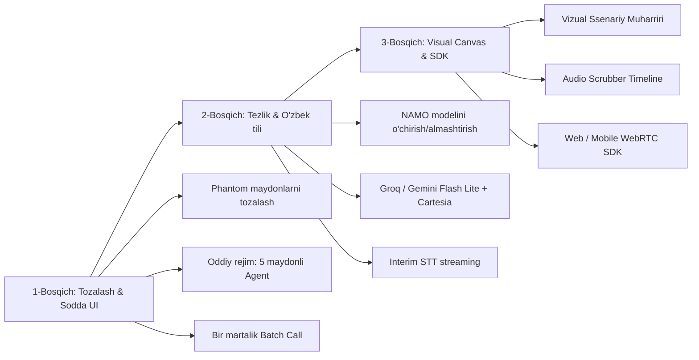

# robot-call-v2 — To'liq Loyiha Auditi va Raqobat Tahlili

> **Hujjat maqsadi:** Loyihaning barcha funksionalliklarini xaritalash, haddan tashqari murakkablashtirilgan (over-engineered) joylarini aniqlash, yaxshilanishi shart bo'lgan texnik va mahsulot kamchiliklarini ko'rsatish hamda jahon yetakchilari (Retell AI, Vapi AI, Bland AI) bilan solishtirib, amaliy yo'l xaritasini belgilash.

---

## 1. Funksionalliklarning To'liq Xaritasi (Bizda nimalar bor?)

Loyihangiz oddiy "ovozli bot" emas — bu **to'liq tsiklli, bank darajasidagi On-Premise AI Contact Center platformasi**. Tizim 7 ta yirik texnologik blokdan iborat:

```
┌────────────────────────────────────────────────────────────────────────┐
│                        ROBOT-CALL-V2 PLATFORMASI                       │
├────────────────────────────────┬───────────────────────────────────────┤
│ 1. Telefoniya & Audio Qatlami  │ Asterisk 20 (ARI), Netty UDP (RTP),   │
│                                │ G.711 (µ/a-law), 8k↔16k resampler,    │
│                                │ Stereo yozuv, MinIO/S3, AMI monitor   │
├────────────────────────────────┼───────────────────────────────────────┤
│ 2. Audio AI & Turn Detection   │ Silero VAD v5, GTCRN Neural Denoiser, │
│                                │ Smart Turn v3 (Bluestein FFT), NAMO   │
│                                │ Text Turn, Dynamic Endpointing, AMD   │
├────────────────────────────────┼───────────────────────────────────────┤
│ 3. Nutq dvijoklari (STT/TTS)   │ STT (6 ta): Yandex v3, Google, Aisha, │
│                                │ Deepgram, OpenAI, Gemini.             │
│                                │ TTS (6 ta): Yandex v3, Google, Aisha, │
│                                │ ElevenLabs, Cartesia, OpenAI.         │
│                                │ Realtime (5 ta): Gemini Live, OpenAI  │
│                                │ Realtime, Moshi, Qwen Omni, Pipecat.  │
├────────────────────────────────┼───────────────────────────────────────┤
│ 4. Muloqot & Intellekt         │ FSM Scenario (StageDef), Fast-Path    │
│                                │ (<20ms), Pre-fillers, Backchanneling, │
│                                │ Barge-in, HTTP Tools (SSRF Guard),    │
│                                │ Dynamic MCP Client, RAG / Vector DB   │
├────────────────────────────────┼───────────────────────────────────────┤
│ 5. Dialer & Kampaniyalar       │ Rejimlar: AI, Predictive, Progressive,│
│                                │ Preview. FIFO vs SCORE (ML) tartib,   │
│                                │ Disposition bo'yicha Retry, SMS Eskiz │
├────────────────────────────────┼───────────────────────────────────────┤
│ 6. PBX & Kontakt Markaz        │ CallFlow (IVR graf: Play, Menu, etc), │
│                                │ Operator navbatlari (SLA), Transfer,  │
│                                │ Wrap-up kodlar, DNC ro'yxat           │
├────────────────────────────────┼───────────────────────────────────────┤
│ 7. Sifat, Billing & Platforma  │ LLM-Judge (Quality), Daily Insights,  │
│                                │ AI Copilot (/ask), Vertical Packs,    │
│                                │ Multi-tenant Ledger Billing, API Keys │
└────────────────────────────────┴───────────────────────────────────────┘
```

### Funksional modullar tafsiloti (50 ta feature):
1. **Telefoniya & RTP (`agent/ari`, `agent/rtp`, `agent/codec`):**
   - Asterisk 20 bilan ARI (ari4java 0.18.0) orqali boshqaruv.
   - Netty NIO orqali to'g'ridan-to'g'ri UDP soketlarida Unicast RTP audio oqimi.
   - G.711 µ-law / A-law dekoder va enkoder (Sun reference implementatsiyasi).
   - 8 kHz (telefon audio) va 16 kHz (AI modellari) o'rtasida linear resampler.
   - 20000–20500 dinamik UDP port allokatori.
   - MinIO/S3 ga yuklash va ffmpeg bilan 32 kbps siqish.
   - AMI orqali PJSIP trunklarini qayta yuklash va monitoring.
2. **Nutqni tushunish va sintez qilish (`agent/stt`, `agent/tts`, `agent/realtime`):**
   - **STT:** Yandex SpeechKit v3 (gRPC streaming, uz-UZ qo'llab-quvvatlaydi), Google Speech streaming, Deepgram, Aisha (mahalliy), OpenAI Whisper, Gemini.
   - **TTS:** Yandex v3, ElevenLabs streaming, Cartesia Sonic, Google, Aisha, OpenAI.
   - **Realtime (Speech-to-Speech):** Gemini Live (bidi WebSocket), OpenAI Realtime (g711_ulaw), Moshi, Qwen Omni, Pipecat Cloud.
   - O'zbek va rus raqamlari, pul birliklari va sanalarini to'g'ri o'qish uchun `SpeechTextNormalizer`, `UzbekNumberWords`, `SpokenNumbers`.
3. **Muloqot boshqaruvi (`agent/dialog`):**
   - FSM (Finite State Machine) ssenariy grafi (`StageDef`, o'tish shartlari, statik jumlalar, natijalar).
   - "Tezkor yo'l" (Fast-path): deterministik niyatlar uchun <20ms va 0 LLM token sarfi.
   - Pre-filler ("Bir soniya...", "Qarab ko'raman...") va backchanneling ("ha", "tushunarli").
   - Barge-in (mijoz bot so'zini bo'lganda darhol to'xtash) va soxta to'xtalishlarni filtrlash.
   - Xavfsiz HTTP Tool Executor (SSRF va DNS rebinding himoyasi bilan).
   - Tashqi tizimlar uchun Model Context Protocol (MCP) mijozi.
4. **Terish tizimi va Kampaniyalar (`campaign`, `dialer`, `contact`):**
   - 4 xil terish rejimi: `AI` (to'liq bot), `PREVIEW` (operator ko'rib teradi), `PROGRESSIVE` (bo'sh operatorga 1 ta), `PREDICTIVE` (statistika asosida oldindan ko'p liniya terish).
   - Nishonlarni tartiblash: `FIFO` yoki `SCORE` (mijozning to'lash ehtimoli va qulay vaqtiga qarab).
   - Natija (disposition) bo'yicha moslashuvchan qayta qo'ng'iroq (Retry Policy) va avtomatik SMS (Eskiz).
   - Qo'ng'iroq oynalari (Dial Window), TCPA vaqt zonalari, bayramlar taqvimi.
5. **Kontakt markaz & PBX (`callflow`, `callqueue`, `operator`, `donotcall`, `wrapup`):**
   - Vizual IVR daraxti: PLAY, MENU (DTMF), SCHEDULE, QUEUE, RING_GROUP, VOICEMAIL, AI_AGENT.
   - Jonli operatorlar navbati, kutish vaqti va SLA nazorati, operatorga brifing bilan transfer.
   - Qora ro'yxat (Do Not Call) va qo'ng'iroq yakuniy kodlari (Wrap-up codes).
6. **Sifat nazorati, Billing & Analitika (`quality`, `insight`, `billing`, `copilot`, `pack`):**
   - LLM-as-judge (har bir qo'ng'iroqni avtomatik baholash).
   - Daily Insight Job (kechasi qo'ng'iroqlarni tahlil qilib, promptni yaxshilash takliflarini berish).
   - AI Copilot: tabiiy tilda qo'ng'iroqlar statistikasini so'rash (`/api/copilot/ask`).
   - Vertikal soha paketlari (`packs/ecommerce.json` va h.k.).
   - Multi-tenant append-only ledger billing, balans rezervatsiyasi, avto-to'ldirish.

---

## 2. Nimalarni Haddan Tashqari Murakkablashtirib Yuborganmiz? (Overengineering)

### 1. Ob'ektlar inflyatsiyasi: Bitta qo'ng'iroq uchun 5 xil tushuncha
Foydalanuvchi bitta qo'ng'iroqni amalga oshirishi uchun quyidagi 5 ta alohida tuzilmani bilishi kerak:
* **`AiAgent`** — ~70 ta parametr (7 ta ichki guruh: `script`, `speechEngine`, `voice`, `ambience`, `callBehaviour`, `limits`, `dataPolicy`).
* **`Scenario`** — alohida graf (`StageDef`, `GlobalNode`, `transitionConditions`, `allowedTransitions`, `branches`, `outcomeSchema`, `factSchema`).
* **`Campaign`** — 30 ta parametr (`schedule`, `retry`, `limits`, `recurrence`, `dialing`, `dialMode`, `overflowPercent`).
* **`CallFlow`** — yana bitta alohida PBX/IVR grafi (8 ta tugun turi).
* **`Pack`** — soha paketlari (bularning hammasini yana JSON orqali generatsiya qiluvchi meta-qatlam).

> **Muammo:** Yangi mijoz yoki direktor tizimga kirganda, "Raqamlar ro'yxatiga qarzdorlikni eslatib chiq" deyishi uchun 100 dan ortiq forma maydonlarini to'ldirishga majbur. Hujjatlarning o'zi bir necha ming qatordan oshib ketgan.

### 2. Koddagi "soxta" va o'lik sozlamalar (Phantom Fields)
Baza va DTO larda mavjud, lekin **real qo'ng'iroqda hech narsaga ta'sir qilmaydigan** parametrlar paydo bo'lgan:
* `preemptiveGeneration`
* `ivrNavigationEnabled`
* `voice.stability`
* `voice.similarityBoost`
* `callBehaviour.endpointingDelayMs`
* `limits.turnTimeoutSeconds`

Bular API va DB ga yuk, foydalanuvchiga esa ortiqcha boshog'riq.

### 3. Ssenariyni aniqlashdagi 3 xil parallel yo'l (Duality of Truth)
Agent nima deyishini hal qilish uchun tizimda bir vaqtning o'zida 3 xil mexanizm yashaydi:
1. `script.scenarioId` — umumiy tashqi ssenariy.
2. `script.definition` — agentning ichiga joylangan ssenariy.
3. `script.systemPrompt` — ssenariysiz PROMPT rejimi.

Bu backend'da `AiAgentService.resolveScenario` da doimiy chalkashliklar, `PUT /scenario` da ma'lumotlar yo'qolishi yoki 409 xatoliklar keltirib chiqargan.

### 4. Turn Detection bo'yicha "Gipertrofiya" (7 ta qatlam!)
Mijoz gapirib bo'lganini bilish uchun tizimda 7 ta parallel filtr ishlaydi:
1. Silero VAD v5 (ONNX)
2. GTCRN Denoiser (ONNX)
3. Smart Turn v3 (Java ichida Bluestein algoritmi bilan 400-nuqtali FFT hisoblash)
4. NAMO Text Turn Detector (310 MB ONNX model + HuggingFace Tokenizer)
5. Transcript Turn Cues (O'zbek/Rus grammatik qo'shimchalari)
6. Dynamic Endpointing
7. VAD Pre/Post roll buferlari

> **Eng katta paradoks:** 310 MB li NAMO modeli **o'zbek tiliga umuman o'rgatilmagan** (`TEXT_TURN_LANGUAGES=ru-RU` turibdi). O'zbek tili uchun foydasi bo'lmagan og'ir neyron model hot-path da CPU va xotirani band qilib turibdi.

### 5. Hexagonal arxitektura byurokratiyasi
Har bir kichik CRUD feature (masalan, `secret`, `wrapup`, `tag`, `partner`) 11–13 ta fayldan iborat:
`Controller` (interfeys) + `ControllerImpl` (1 qator) + `UseCase` + `Repository` (interfeys) + `Service` + `Mapper` + `Domain Entity` + `JpaEntity` + `JpaRepository` + `RepositoryAdapter` + `EntityMapper` + `DTOs`.
50 ta feature uchun **600 dan ortiq boilerplate klasslar** yozilgan. Bitta yangi maydon qo'shish uchun 7 ta faylni qo'lda o'zgartirish talab qilinadi.

### 6. Cascade vs Realtime — ikki xil parallel dvijok
Kaskadli pipeline (`STT -> LLM -> TTS`) va Realtime API (`Gemini Live / OpenAI Realtime`) uchun alohida ikki xil sessiya, ikki xil audio ko'prik va ikki xil tool ijrosi mavjud. Bu ikki dvijok orasida funksional tenglikni ushlab turish katta resurs talab qiladi.

---

## 3. Nimalarni Yaxshilashimiz Kerak? (Improvement Areas)

### 1. Kechikishni qisqartirish (Latency: 1.5s dan 600ms ga tushirish)
Hozirgi kaskadli zanjirda:
* VAD + Sukunat aniqlash: ~400ms
* STT Final transkript: ~300ms
* LLM Time-to-First-Token (Gemini Flash): ~350ms
* TTS Birinchi audio chunk (Yandex/ElevenLabs): ~300ms
* Jitter buffer + Tarmoq: ~100ms
* **Jami kechikish: 1400 – 1800 ms!**

Inson suhbatida 1.5 soniyalik pauza g'alati tuyuladi.
* **Yechim:** 
  1. STT ning `interim` (oraliq) natijasini to'g'ridan-to'g'ri LLM ga uzatish (spekulyativ prompt boshlash).
  2. Birinchi gap bo'laklari uchun ultra-tez model (masalan, Groq Llama-3.3 yoki Gemini Flash Lite) va ultra-tez TTS (Cartesia Sonic / Deepgram Aura) ni asosiy qilib qo'yish.

### 2. O'zbek tili nutqi va kontekst intellekti
* **Dialektlar va aralash nutq:** O'zbekistonda ko'p mijozlar ruscha-o'zbekcha aralashtirib gapiradi ("kartam blok bo'lib qoldi", "oplata qildim"). STT bu so'zlarni xato yozadi. Promptlarda va `SpeechTextNormalizer` da transliteratsiya va ruscha jargonlar bilan ishlashni kuchaytirish zarur.
* **Raqamlar va hisob-kitoblar:** `UzbekNumberWords` mavjud bo'lsa-da, katta pullar ("1 250 000 so'm" -> "bir million ikki yuz ellik ming") ba'zan TTS da noto'g'ri o'qiladi. SSML va fonetik normalizatsiyani chuqurlashtirish kerak.

### 3. No-Code Visual Builder (Grafik Muharrir)
* Foydalanuvchilar JSON orqali `StageDef` yoki `transitionConditions` yozolmaydi.
* Ssenariy muharririni vizual (daraxtsimon yoki blokli) ko'rinishga keltirish kerak: "Mijoz rozi bo'lsa -> A bosqich", "Rad etsa -> B bosqich".

### 4. Audio Observability & Scrubber (Vizual tekshiruv)
* Hozir qo'ng'iroqni faqat loglar va matn orqali tahlil qilish mumkin.
* Qo'ng'iroq yozuvini vaqt shkalasida ko'rish imkoniyati kerak:
  * Qaysi millisekundda foydalanuvchi gapirdi?
  * Qaysi nuqtada VAD uzdi?
  * STT qachon matn berdi?
  * LLM qancha vaqt o'yladi?
  * TTS qachon ovoz chiqardi?

### 5. WebRTC SDK (Faqat SIP telefoniya bilan cheklanib qolmaslik)
* Hozir tizim asosan SIP liniyalar (Asterisk) ga qattiq bog'langan. Brauzerdan sinash uchun `web-test.html` Asterisk WebRTC portiga ulanadi.
* Saytlar va mobil ilovalar uchun yengil WebRTC SDK (JavaScript / React / Flutter kutubxonasi) yaratilsa, bizneslar o'z saytlariga "AI maslahatchi bilan gaplashish" tugmasini 1 qatorda qo'ya oladi.

---

## 4. Raqobatchilar bilan Taqqoslash (Qayerda ortda qolyapmiz?)

| Xususiyat | **Retell AI / Vapi AI** | **Bland AI** | **Bizning tizim (robot-call-v2)** | Bizning holat |
|---|---|---|---|---|
| **Time to First Call** (Birinchi qo'ng'iroqqacha vaqt) | **1–2 daqiqa.** Prompt yozasiz, ovoz tanlaysiz, raqamingizni kiritasiz — telefoningizga qo'ng'iroq boradi. | **2 daqiqa.** "Talk in browser" yoki to'g'ridan-to'g'ri raqamga chaqiruv. | **15–30 daqiqa.** Trunk, Asterisk, PJSIP, Agent, Ssenariy, Kampaniya sozlanishi shart. | ❌ **Jiddiy ortdamiz** (Onboarding juda qiyin) |
| **Kechikish (Turn Latency)** | **450 – 700 ms** (Edge infratuzilma, Groq/Cartesia ultra-tez streaming). | **600 – 900 ms**. | **1100 – 1800 ms** (Asterisk -> Netty RTP -> gRPC STT -> Spring Boot -> TTS). | ❌ **Ortda qolyapmiz** (Suhbat sekinroq) |
| **Ssenariy muharriri** | **Visual Conversation Flow** (Daraxtsimon, drag-and-drop, shartli yo'llar). | **Conversational Pathways** (No-code vizual daraxt). | **JSON / Matnli forma** (`StageDef`, kodli o'tish shartlari). | ❌ **Ortdamiz** (UI murakkab) |
| **Client SDK lar** | `@vapi-ai/web`, React hooks (`useVapi`), Flutter, iOS Swift, Android Kotlin SDK. | Web widget, REST batch API. | Faqat REST API, bitta `web-test.html` va oddiy iframe vidjet. | ❌ **Ortdamiz** (Frontendchilar integratsiyasiga qulay emas) |
| **Batch Calling (Ommaviy chaqiruv)** | 1 ta API so'rovi: `POST /v2/create-batch-call` (Agent ID + Raqamlar ro'yxati). | 1 ta API so'rovi. | `Campaign` yaratish, `targets/csv` yuklash, `start` buyrug'ini berish. | ⚠️ **Murakkab** |
| **Sintetik testlash (Agent simulation)** | 50 ta LLM persona (injiz, asabiy, shoshayotgan) agentga parallel qo'ng'iroq qilib, promptni stress-test qiladi. | Bor. | `test-cases` va `Quality` baholash bor, lekin real-time audio simulyatsiya to'liq emas. | ⚠️ **O'rtacha** |
| **O'zbek tili va Mahalliy integratsiya** | O'zbek tilini yaxshi bilmaydi, mahalliy SMS (Eskiz) yoki Uysot CRM yo'q. | O'zbek tilida sifatsiz. | **Mukammal:** Yandex v3, Aisha STT/TTS, Eskiz SMS, Uysot CRM, O'zbek raqam parseri. | ✅ **BIZ YUTAMIZ** |
| **On-Premise & Bank talablari** | Faqat Cloud (AQSh serverlari). Bank va MFO ma'lumotlarini qabul qilolmaydi. | Faqat Cloud. | **100% On-Premise:** Docker, PostgreSQL, Asterisk, mahalliy SIP trunklar (Qonun 647 ga mos). | ✅ **BIZ YUTAMIZ** |
| **PBX & Operator Navbatlari** | Cheklangan (faqat oddiy transfer). | Cheklangan. | **To'liq Kontakt Markaz:** Predictive dialer, SLA, Operator Queues, Wrap-up, Quiet hours. | ✅ **BIZ YUTAMIZ** |

---

## 5. Bizning Eng Kuchli Tomonlarimiz (Ularda yo'q narsalar)

Loyiha arxitekturasi zaif emas — aksincha, u **O'zbekiston korporativ bozori (Banklar, Sug'urta, MFO, E-commerce)** uchun noyob bo'lgan jiddiy ustunliklarga ega:

1. **Bank talablari va Ma'lumotlar xavfsizligi (100% On-Premise):**
   Retell yoki Vapi O'zbekiston banklariga kira olmaydi, chunki bank siri va shaxsiy ma'lumotlarni xorijga olib chiqish qonunan taqiqlangan. Sizning loyihangiz esa to'liq korporativ tarmoq ichida (Private Cloud / On-Premise) ishlaydi.
2. **Kompaniya darajasidagi Multi-tenancy va SSRF Guard:**
   `company_id` qat'iy izolyatsiyasi, tenant URL lariga so'rovlarda DNS-rebinding va SSRF hujumlaridan himoya (`PublicUrlGuard`, `PublicHttpClientFactory`), AES-GCM shifrlash.
3. **Murakkab Dialer turlari:**
   Ko'plab global platformalarda faqat oddiy ketma-ket qo'ng'iroq bor. Sizda esa haqiqiy Call-center darajasidagi **Predictive Dialing** (operator bo'shashini bashorat qilib oldindan terish) va to'lov ehtimolligiga asoslangan **SCORE tartiblash** mavjud.
4. **Aniq Moliyaviy Ledger (Billing):**
   Append-only tranzaksiyalar, pre-call balans rezervatsiyasi, millisekund va tokenlar bo'yicha shaffof narxlash.

---

## 6. Amaliy Yo'l Xaritasi (Nimalarni qanday qilish kerak?)



### 1-bosqich: Tozalash va Mahsulotni soddalashtirish (1–2 hafta)
1. **O'lik sozlamalarni olib tashlash:** `preemptiveGeneration`, `ivrNavigationEnabled`, `voiceStability`, `voiceSimilarityBoost`, `endpointingDelayMs`, `turnTimeoutSeconds` kabi runtime'da ishlamaydigan maydonlarni API hujjatlari va formalaridan tozalash.
2. **"Oddiy rejim"ni bosh sahifaga chiqarish:**
   - Agent yaratish: faqat **Nom**, **Vazifa (Prompt)**, **Til**, **Ovoz**, **Salomlashish**.
   - Qolgan 65 ta sozlamani "Ekspert / Qo'shimcha" tugmasi ostiga yashirish.
3. **1-klikli Batch Call:** Kampaniya yaratishni murakkablashtirmasdan, "Agentni tanlang -> CSV tashlang -> Boshlash" oqimini yaratish.

### 2-bosqich: Ovoz dvijoki va Kechikishni yechish (2–3 hafta)
1. **NAMO modelini olib tashlash:** O'zbekchaga o'rgatilmagan 310 MB li neyron modelni hot-path dan chiqarish. O'rniga mavjud Silero VAD v5 + `TranscriptTurnCues` (morfologik qoidalar) ning o'zi ancha tezroq va aniqroq ishlaydi.
2. **Eng tezkor profilni birlamchi qilish:** Gemini Flash Lite yoki Groq (Llama-3.3) + Cartesia Sonic / Yandex v3 streaming kombinatsiyasini asosiy profil qilib, kechikishni 700–800 ms gacha tushirish.

### 3-bosqich: Mahsulot darajasiga ko'tarish (1 oy)
1. **Visual Conversation Builder:** Ssenariylarni JSON emas, vizual bloklar orqali boshqarish.
2. **Audio Inspector / Timeline:** Qo'ng'iroq tafsilotlarida audio to'lqin, VAD, STT va LLM hodisalarini millisekundlarda ko'rsatuvchi pleyer.
3. **WebRTC Web/Mobile Client:** Saytlar uchun bitta JS skript orqali ishlaydigan vidjet.
