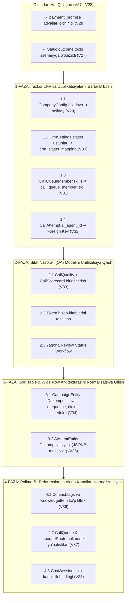

# Robot-Call-V2: Entity Normalizatsiyasi Bo'yicha Yangilangan Reja (Updated Implementation Plan)

Ushbu reja loyihadagi so'nggi o'zgarishlar (xususan, **`V27__static_tools_to_scenario_tools.sql`**, **`V28__drop_payment_promise.sql`** va **`V22-V26` campaign kengaytmalari**) to'liq inobatga olingan holda yangilandi.

---

## Foydalanuvchi Kiritgan O'zgarishlar Tahlili va Rejaga Ta'siri

| Foydalanuvchi Qilgan O'zgarishi | Natijasi va Rejaga Ta'siri |
|---|---|
| **`V28__drop_payment_promise.sql` va `promise` paketi o'chirilishi** | `payment_promise` va `payment_promise_settings` jadvallari butunlay tugatildi. To'lov va'dasi endi faqat `call_result.promised_date` va `call_result.promised_amount` da saqlanadi. **Avvalgi rejamizdagi 1.2-band (PaymentPromise vs CallResult duplikatsiyasi) to'liq hal etildi.** |
| **`V27__static_tools_to_scenario_tools.sql`** | Statik tool'lar koddan olinib, ssenariylarning o'zining `ToolDef` siga o'tkazildi. Outcome ma'lumotlari bevosita ssenariy vositalari orqali shakllanadi. |
| **`V22` – `V26` Campaign yangi ustunlari** | `campaign` jadvaliga `kind`, `sequence JSONB`, `auto_enroll JSONB`, `local_presence_enabled`, `consent_required`, `consent_revoked_action` qo'shildi. Bu `campaign` jadvalini 45+ ustunga yetkazdi va JSONB yuklamasini oshirdi. **3-Fazadagi `CampaignEntity` dekompozitsiyasi endi ushbu yangi ustunlarni ham qamrab oladi.** |
| **Migratsiya raqamlari siljishi** | Eng oxirgi migratsiya `V28` bo'lgani sababli, keyingi qadamlar **`V29__...`** dan boshlanadi. |

---

## Yangilangan Yol Xaritasi (Updated Roadmap)



---

## 1-FAZA: Tezkor 1NF va Duplikatsiyalarni Bartaraf Etish (Hafta 1)

> [!IMPORTANT]
> Ushbu faza mavjud logikaga xalaqit bermasdan, bazadagi ziddiyatli satrli ro'yxatlarni toza relyatsion jadvallarga aylantiradi.

### 1.1. `CompanyConfig.holidays` ziddiyatini yo'qotish va mavjud `holiday` relyatsion jadvaliga to'liq o'tish
- **Muammo:** [`CompanyConfigEntity`](file:///C:/Users/Murodjon/IdeaProjects/robot-call-v2/src/main/java/uz/murodjon/robotcallv2/company/infrastructure/persistence/entity/CompanyConfigEntity.java) ichidagi `holidays TEXT` ustunida vergul bilan ajratilgan sanalar saqlanadi, vaholanki loyihada to'laqonli [`HolidayEntity`](file:///C:/Users/Murodjon/IdeaProjects/robot-call-v2/src/main/java/uz/murodjon/robotcallv2/schedule/infrastructure/persistence/entity/HolidayEntity.java) jadvali mavjud.
- **Flyway Migratsiya:** `V29__drop_company_config_holidays.sql`
  ```sql
  -- 1. company_config da qolib ketgan sanalarni holiday jadvaliga ko'chirish
  INSERT INTO holiday (company_id, holiday_date, name, kind, created_at)
  SELECT cc.company_id, cast(trim(h.d) AS date), 'Dam olish kuni', 'CLOSED', now()
  FROM company_config cc
  CROSS JOIN LATERAL unnest(string_to_array(cc.holidays, ',')) AS h(d)
  WHERE cc.holidays IS NOT NULL AND trim(h.d) <> ''
  ON CONFLICT (company_id, holiday_date) DO NOTHING;

  -- 2. Eskirgan unnormalizatsiya qilingan ustunni o'chirish
  ALTER TABLE company_config DROP COLUMN holidays;
  ```
- **Java Kodidagi o'zgarishlar:**
  1. [`CompanyConfigEntity.java`](file:///C:/Users/Murodjon/IdeaProjects/robot-call-v2/src/main/java/uz/murodjon/robotcallv2/company/infrastructure/persistence/entity/CompanyConfigEntity.java): `holidays` maydoni va uning getter/setterlarini o'chirish.
  2. [`CompanyConfig.java`](file:///C:/Users/Murodjon/IdeaProjects/robot-call-v2/src/main/java/uz/murodjon/robotcallv2/company/domain/entity/CompanyConfig.java): `List<LocalDate> holidays` komponentini olib tashlash.
  3. [`CampaignOutcomeService.java`](file:///C:/Users/Murodjon/IdeaProjects/robot-call-v2/src/main/java/uz/murodjon/robotcallv2/campaign/application/service/CampaignOutcomeService.java): `holidaysOf(companyId)` metodini `CompanyConfig` o'rniga `HolidayUseCase` orqali olishga ulash.
  4. [`CompanyConfigService.java`](file:///C:/Users/Murodjon/IdeaProjects/robot-call-v2/src/main/java/uz/murodjon/robotcallv2/company/application/service/CompanyConfigService.java) va [`UpdateCompanyConfigRequest.java`](file:///C:/Users/Murodjon/IdeaProjects/robot-call-v2/src/main/java/uz/murodjon/robotcallv2/company/application/dto/UpdateCompanyConfigRequest.java): bayram kunlari sozlamasini tozalash (bayramlar `BusinessScheduleController` da `/api/holidays` orqali to'liq boshqariladi).
- **Tekshiruv mezoni:** Dialer va qayta qo'ng'iroq rejalashtiruvchisi (`RetrySchedule`) faqat `holiday` jadvali bo'yicha bayram kunlarini aylanib o'tadi.

---

### 1.2. `CrmSettings` outcome statuslarini `crm_status_mapping` relyatsion jadvaliga o'tkazish
- **Muammo:** Har bir outcome turi uchun alohida ustun (`meeting_booked_status_id`, `promise_to_pay_status_id`, `not_interested_status_id`, `callback_status_id`, `new_lead_status_id`) ochilgan.
- **Flyway Migratsiya:** `V30__crm_status_mapping.sql`
  ```sql
  CREATE TABLE crm_status_mapping (
      company_id  BIGINT      NOT NULL REFERENCES company(id) ON DELETE CASCADE,
      disposition VARCHAR(32) NOT NULL,
      status_id   INTEGER     NOT NULL,
      PRIMARY KEY (company_id, disposition)
  );

  -- Mavjud ma'lumotlarni yangi relyatsion jadvalga ko'chirish
  INSERT INTO crm_status_mapping (company_id, disposition, status_id)
  SELECT company_id, 'MEETING_BOOKED', meeting_booked_status_id FROM crm_settings WHERE meeting_booked_status_id IS NOT NULL
  UNION ALL
  SELECT company_id, 'PROMISE_TO_PAY', promise_to_pay_status_id FROM crm_settings WHERE promise_to_pay_status_id IS NOT NULL
  UNION ALL
  SELECT company_id, 'NOT_INTERESTED', not_interested_status_id FROM crm_settings WHERE not_interested_status_id IS NOT NULL
  UNION ALL
  SELECT company_id, 'CALLBACK_REQUESTED', callback_status_id FROM crm_settings WHERE callback_status_id IS NOT NULL
  UNION ALL
  SELECT company_id, 'NEW_LEAD', new_lead_status_id FROM crm_settings WHERE new_lead_status_id IS NOT NULL;

  ALTER TABLE crm_settings
      DROP COLUMN meeting_booked_status_id,
      DROP COLUMN promise_to_pay_status_id,
      DROP COLUMN not_interested_status_id,
      DROP COLUMN callback_status_id,
      DROP COLUMN new_lead_status_id;
  ```
- **Java Kodidagi o'zgarishlar:**
  1. Yangi Entity: `CrmStatusMappingEntity.java` (`company_id`, `disposition`, `status_id`).
  2. [`CrmSettings.java`](file:///C:/Users/Murodjon/IdeaProjects/robot-call-v2/src/main/java/uz/murodjon/robotcallv2/crm/domain/entity/CrmSettings.java): `Map<Disposition, Integer> statusMappings` xaritasini saqlash.
  3. [`CrmService.java`](file:///C:/Users/Murodjon/IdeaProjects/robot-call-v2/src/main/java/uz/murodjon/robotcallv2/crm/application/service/CrmService.java): qat'iy if-else o'rniga `settings.statusFor(disposition)` orqali olish.
- **Tekshiruv mezoni:** Yangi outcome (masalan, `SURVEY_COMPLETED` yoki `PAYMENT_CLAIMED`) qo'shilganda DB migratsiyasiz CRM status xaritalanadi.

---

### 1.3. `CallQueueMember.skills` ni relyatsion jadvalga ajratish
- **Muammo:** `call_queue_member` dagi `skills VARCHAR(255)` vergul bilan ajratilgan satr.
- **Flyway Migratsiya:** `V31__call_queue_member_skills.sql`
  ```sql
  CREATE TABLE call_queue_member_skill (
      queue_id BIGINT      NOT NULL,
      user_id  BIGINT      NOT NULL,
      skill    VARCHAR(64) NOT NULL,
      PRIMARY KEY (queue_id, user_id, skill),
      CONSTRAINT fk_cqm_skill FOREIGN KEY (queue_id, user_id)
          REFERENCES call_queue_member(queue_id, user_id) ON DELETE CASCADE
  );

  INSERT INTO call_queue_member_skill (queue_id, user_id, skill)
  SELECT queue_id, user_id, trim(s.val)
  FROM call_queue_member cqm
  CROSS JOIN LATERAL unnest(string_to_array(cqm.skills, ',')) AS s(val)
  WHERE cqm.skills IS NOT NULL AND trim(s.val) <> '';

  ALTER TABLE call_queue_member DROP COLUMN skills;
  ```
- **Java Kodidagi o'zgarishlar:**
  1. [`CallQueueMemberEntity.java`](file:///C:/Users/Murodjon/IdeaProjects/robot-call-v2/src/main/java/uz/murodjon/robotcallv2/callqueue/infrastructure/persistence/entity/CallQueueMemberEntity.java): `Set<String> skills` to'plamini `@ElementCollection` orqali saqlash.
  2. Navbat marshrutlash xizmati (`QueueCallRouter`): Operator tanlashda indekslangan join so'rovi orqali tilga mos operatorni aniqlash.

---

### 1.4. `CallAttempt.ai_agent_id` ga tashqi kalit (FK) qo'shish
- **Flyway Migratsiya:** `V32__call_attempt_ai_agent_fk.sql`
  ```sql
  -- Yetim qatorlarni tozalash (agar ai_agent jadvalida yo'q bo'lgan id yozilgan bo'lsa)
  UPDATE call_attempt SET ai_agent_id = NULL
  WHERE ai_agent_id IS NOT NULL AND ai_agent_id NOT IN (SELECT id FROM ai_agent);

  ALTER TABLE call_attempt
      ADD CONSTRAINT fk_call_attempt_ai_agent
      FOREIGN KEY (ai_agent_id) REFERENCES ai_agent(id) ON DELETE SET NULL;
  ```
- **Java Kodidagi o'zgarishlar:**
  [`CallAttemptEntity.java`](file:///C:/Users/Murodjon/IdeaProjects/robot-call-v2/src/main/java/uz/murodjon/robotcallv2/callrecord/infrastructure/persistence/entity/CallAttemptEntity.java): `aiAgent` assotsiatsiyasi va xavfsiz bog'lanish.

---

## 2-FAZA: Sifat Nazorati (QA) Modelini Unifikatsiya Qilish (Hafta 2)

> [!NOTE]
> `CallQualityEntity` (AI metriklari: guardrails, barge-in, turns) va `CallScorecardEntity` (inson/mezonli baholash) jadvallaridagi parallel ustunlar (`score`, `review_status`, `reviewed_by`, `reviewed_at`, `sentiment`, `tokens`) yagona baholash arxitekturasiga birlashtiriladi.

### 2.1. Yagona `CallEvaluation` modeliga o'tish
- **Flyway Migratsiya:** `V33__unify_call_evaluation.sql`
  ```sql
  -- call_quality jadvalini asosiy call_evaluation ga aylantirish
  ALTER TABLE call_quality RENAME TO call_evaluation;

  -- Mezonli baholash javoblari referensini yangilash
  ALTER TABLE call_scorecard_answer
      DROP CONSTRAINT IF EXISTS call_scorecard_answer_call_id_fkey,
      ADD CONSTRAINT fk_scorecard_answer_eval
      FOREIGN KEY (call_id) REFERENCES call_evaluation(call_attempt_id) ON DELETE CASCADE;

  ALTER TABLE call_scorecard_topic
      DROP CONSTRAINT IF EXISTS call_scorecard_topic_call_id_fkey,
      ADD CONSTRAINT fk_scorecard_topic_eval
      FOREIGN KEY (call_id) REFERENCES call_evaluation(call_attempt_id) ON DELETE CASCADE;

  -- Ortiqcha parallel call_scorecard jadvalini tugatish
  DROP TABLE IF EXISTS call_scorecard;
  ```
- **Java Kodidagi o'zgarishlar:**
  1. `quality` paketidagi ikkita parallel domen modelini birlashtirish:
     - `CallEvaluation` (avtomatik signallar + insoniy review + baholash mezonlari ro'yxati).
  2. Bitta yagona `CallReviewController` orqali ham bot qoidabuzarliklarini, ham supervayzer tuzatishlarini boshqarish.
  3. Supervayzer statuslari uchun yagona enum: `PENDING`, `APPROVED`, `REJECTED`, `CORRECTED`.

---

## 3-FAZA: God Table & Wide Row Arxitekturasini Normalizatsiya Qilish (Hafta 3-4)

### 3.1. `CampaignEntity` ni Dekompozitsiya Qilish (V22-V26 yangi ustunlari bilan)
- **Muammo:** `campaign` jadvali V22-V26 dan so'ng **45+ ustunga** yetdi (`kind`, `sequence JSONB`, `auto_enroll JSONB`, `local_presence_enabled`, `consent_required`, `consent_revoked_action`).
- **Flyway Migratsiya:** `V34__decompose_campaign.sql`
  ```sql
  -- 1. Dialer sozlamalari jadvali
  CREATE TABLE campaign_dialer_config (
      campaign_id             BIGINT      PRIMARY KEY REFERENCES campaign(id) ON DELETE CASCADE,
      dial_mode               VARCHAR(20) NOT NULL DEFAULT 'AI',
      call_queue_id           BIGINT      REFERENCES call_queue(id) ON DELETE SET NULL,
      max_ai_overflow_percent INT         NOT NULL DEFAULT 20,
      max_concurrent_calls    INT         NOT NULL DEFAULT 20,
      daily_call_cap          INT         NOT NULL DEFAULT 0,
      priority                INT         NOT NULL DEFAULT 3,
      target_ordering         VARCHAR(16) NOT NULL DEFAULT 'FIFO',
      local_presence_enabled  BOOLEAN     NOT NULL DEFAULT false,
      caller_id_pool_id       BIGINT      REFERENCES caller_id_pool(id) ON DELETE SET NULL
  );

  -- 2. Kampaniya jadvali (rejalashtirish)
  CREATE TABLE campaign_schedule (
      campaign_id             BIGINT      PRIMARY KEY REFERENCES campaign(id) ON DELETE CASCADE,
      dial_window_start       TIME        NOT NULL DEFAULT '07:00',
      dial_window_end         TIME        NOT NULL DEFAULT '23:00',
      recurrence_type         VARCHAR(20) NOT NULL DEFAULT 'ONCE',
      recurring_day_of_month  INTEGER,
      cron_expression         VARCHAR(100),
      auto_reset_targets      BOOLEAN     NOT NULL DEFAULT false,
      start_at                TIMESTAMPTZ,
      end_at                  TIMESTAMPTZ,
      last_run_at             TIMESTAMPTZ
  );

  -- 3. Relyatsion Retry Policy (JSONB massiv o'rniga!)
  CREATE TABLE campaign_retry_policy (
      id            BIGSERIAL   PRIMARY KEY,
      campaign_id   BIGINT      NOT NULL REFERENCES campaign(id) ON DELETE CASCADE,
      disposition   VARCHAR(32) NOT NULL,
      max_attempts  INT         NOT NULL,
      delay_minutes INT         NOT NULL,
      UNIQUE (campaign_id, disposition)
  );

  -- 4. Rozilik va Cheklovlar (Consent)
  CREATE TABLE campaign_consent_config (
      campaign_id            BIGINT      PRIMARY KEY REFERENCES campaign(id) ON DELETE CASCADE,
      consent_required       BOOLEAN     NOT NULL DEFAULT false,
      consent_revoked_action VARCHAR(32) NOT NULL DEFAULT 'DROP'
  );

  -- 5. Ma'lumotlarni ko'chirish
  INSERT INTO campaign_dialer_config (campaign_id, dial_mode, call_queue_id, max_ai_overflow_percent, max_concurrent_calls, daily_call_cap, priority, target_ordering, local_presence_enabled, caller_id_pool_id)
  SELECT id, dial_mode, call_queue_id, max_ai_overflow_percent, max_concurrent_calls, daily_call_cap, priority, target_ordering, local_presence_enabled, caller_id_pool_id FROM campaign;

  INSERT INTO campaign_schedule (campaign_id, dial_window_start, dial_window_end, recurrence_type, recurring_day_of_month, cron_expression, auto_reset_targets, start_at, end_at, last_run_at)
  SELECT id, dial_window_start, dial_window_end, recurrence_type, recurring_day_of_month, cron_expression, auto_reset_targets, start_at, end_at, last_run_at FROM campaign;

  INSERT INTO campaign_consent_config (campaign_id, consent_required, consent_revoked_action)
  SELECT id, consent_required, consent_revoked_action FROM campaign;

  -- 6. campaign jadvalini yengillashtirish (faqat id, company_id, name, kind, status, ai_agent_id qoladi)
  ALTER TABLE campaign
      DROP COLUMN dial_mode, DROP COLUMN call_queue_id, DROP COLUMN max_ai_overflow_percent,
      DROP COLUMN max_concurrent_calls, DROP COLUMN daily_call_cap, DROP COLUMN priority,
      DROP COLUMN target_ordering, DROP COLUMN local_presence_enabled, DROP COLUMN caller_id_pool_id,
      DROP COLUMN dial_window_start, DROP COLUMN dial_window_end, DROP COLUMN recurrence_type,
      DROP COLUMN recurring_day_of_month, DROP COLUMN cron_expression, DROP COLUMN auto_reset_targets,
      DROP COLUMN start_at, DROP COLUMN end_at, DROP COLUMN retry_policy,
      DROP COLUMN consent_required, DROP COLUMN consent_revoked_action;
  ```
- **Java Kodidagi o'zgarishlar:**
  [`CampaignEntity.java`](file:///C:/Users/Murodjon/IdeaProjects/robot-call-v2/src/main/java/uz/murodjon/robotcallv2/campaign/infrastructure/persistence/entity/CampaignEntity.java) ixchamlashtiriladi, domen modeli `Campaign` dagi `CampaignSchedule`, `CampaignDialerConfig`, `CampaignConsent` o'zlarining alohida jadvallariga saqlanadi.

---

### 3.2. `AiAgentEntity` Dekompozitsiyasi va JSONB Massivlarni Ajratish
- **Flyway Migratsiya:** `V35__decompose_ai_agent.sql`
  ```sql
  -- 1. Talaffuz qoidalari (JSONB massivdan relyatsion jadvalga)
  CREATE TABLE ai_agent_pronunciation_rule (
      id             BIGSERIAL    PRIMARY KEY,
      ai_agent_id    BIGINT       NOT NULL REFERENCES ai_agent(id) ON DELETE CASCADE,
      word           VARCHAR(128) NOT NULL,
      replacement    VARCHAR(256) NOT NULL,
      language       VARCHAR(10)  NOT NULL DEFAULT '*',
      case_sensitive BOOLEAN      NOT NULL DEFAULT true
  );

  -- 2. Agent qo'llanmasi qoidalari (Handbook)
  CREATE TABLE ai_agent_handbook_item (
      id          BIGSERIAL    PRIMARY KEY,
      ai_agent_id BIGINT       NOT NULL REFERENCES ai_agent(id) ON DELETE CASCADE,
      title       VARCHAR(255) NOT NULL,
      content     TEXT         NOT NULL,
      sort_order  INT          NOT NULL DEFAULT 0
  );

  -- 3. Telefoniya va muhit parametrlari (Ambience & Telephony)
  CREATE TABLE ai_agent_telephony_config (
      ai_agent_id                   BIGINT       PRIMARY KEY REFERENCES ai_agent(id) ON DELETE CASCADE,
      ambient_sound                 VARCHAR(32)  NOT NULL DEFAULT 'OFFICE',
      ambient_sound_volume          FLOAT        NOT NULL DEFAULT 1.0,
      thinking_sound                VARCHAR(32)  NOT NULL DEFAULT 'OFF',
      noise_cancellation_enabled    BOOLEAN      NOT NULL DEFAULT true,
      interruption_threshold_ms     INT          NOT NULL DEFAULT 200,
      max_call_duration_seconds     INT          NOT NULL DEFAULT 600
  );

  -- 4. ai_agent jadvalini tozalash
  ALTER TABLE ai_agent
      DROP COLUMN pronunciation_rules,
      DROP COLUMN handbook,
      DROP COLUMN ambient_sound,
      DROP COLUMN ambient_sound_volume,
      DROP COLUMN ambient_sound_fade_in_seconds,
      DROP COLUMN thinking_sound,
      DROP COLUMN thinking_sound_volume,
      DROP COLUMN noise_cancellation_enabled,
      DROP COLUMN noise_cancellation_mode;
  ```
- **Java Kodidagi o'zgarishlar:**
  1. `AiAgentPronunciationRuleEntity.java` va `AiAgentHandbookItemEntity.java` yaratiladi.
  2. [`AiAgentEntity.java`](file:///C:/Users/Murodjon/IdeaProjects/robot-call-v2/src/main/java/uz/murodjon/robotcallv2/aiagent/infrastructure/persistence/entity/AiAgentEntity.java): JSONB qatorlar o'rniga munosabatlar qo'yiladi.

---

## 4-FAZA: Polimorfik Referenslar va Aloqa Kanallari Normalizatsiyasi (Hafta 5)

### 4.1. `Contact.tags` va `KnowledgeItem` ko'p tillilik (`V36`)
- `contact.tags` ustunini `contact_tag` relyatsion jadvaliga chiqarish.
- `knowledge_base_item` dagi `answer_uz`, `answer_ru`, `answer_en` ustunlarini `knowledge_item_translation (item_id, language, answer)` jadvaliga o'tkazish.

### 4.2. Polimorfik referenslarni aniq FK ustunlariga ajratish (`V37`)
- [`CallQueueEntity.overflowTarget`](file:///C:/Users/Murodjon/IdeaProjects/robot-call-v2/src/main/java/uz/murodjon/robotcallv2/callqueue/infrastructure/persistence/entity/CallQueueEntity.java) va [`InboundRouteEntity.afterHoursDestination`](file:///C:/Users/Murodjon/IdeaProjects/robot-call-v2/src/main/java/uz/murodjon/robotcallv2/inbound/infrastructure/persistence/entity/InboundRouteEntity.java) dagi matnli referenslarni aniq FK ustunlariga ajratish:
  - `overflow_queue_id REFERENCES call_queue(id)`
  - `overflow_agent_id REFERENCES ai_agent(id)`
  - `overflow_voicemail_id REFERENCES voicemail_box(id)`
  - `overflow_external_phone VARCHAR(32)`

---

## Xulosa va Navbatdagi Harakat

Reja siz kiritgan o'zgarishlar bilan to'liq sinxronlashtirildi:
1. `payment_promise` bo'yicha duplikatsiya masalasi V28 bilan yopildi deb qayd etildi.
2. `campaign` dekompozitsiyasi yangi qo'shilgan `sequence`, `auto_enroll`, `consent` maydonlarini hisobga olgan holda boyitildi.
3. Yangi migratsiyalar tartibi **`V29`** dan boshlandi.

Rejaning **1-Fazasidan (1.1-qadam: `CompanyConfig.holidays` ni `holiday` jadvaliga to'liq ko'chirish — `V29`)** boshlashga tayyormiz!
